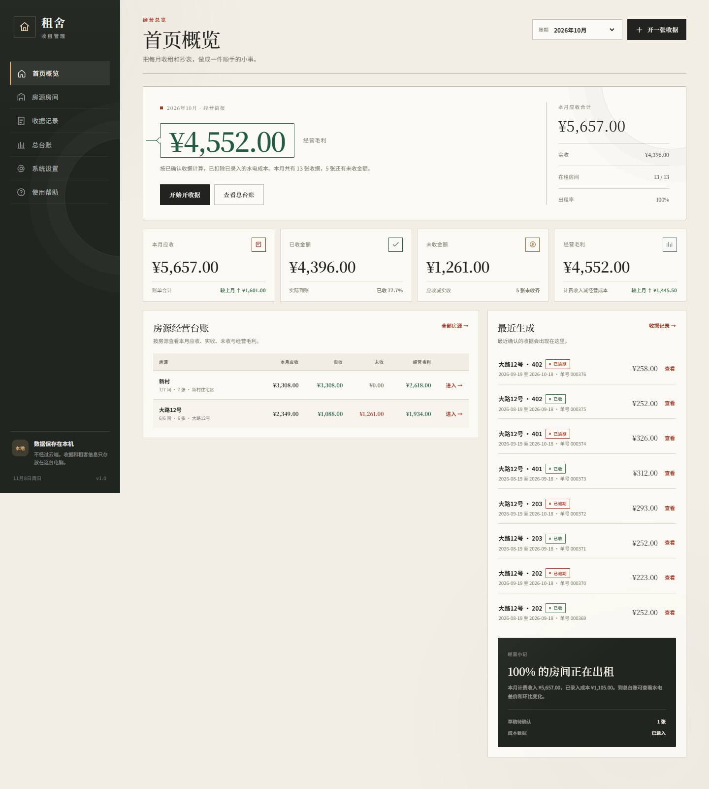
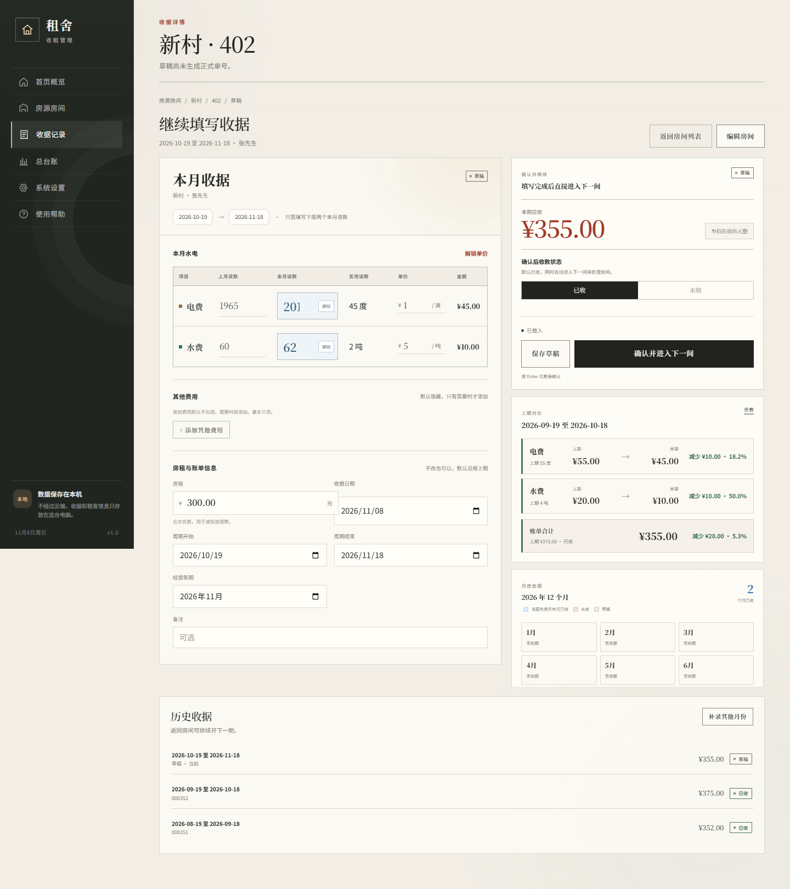
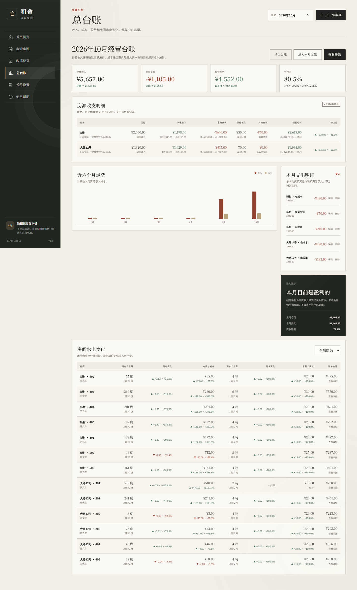
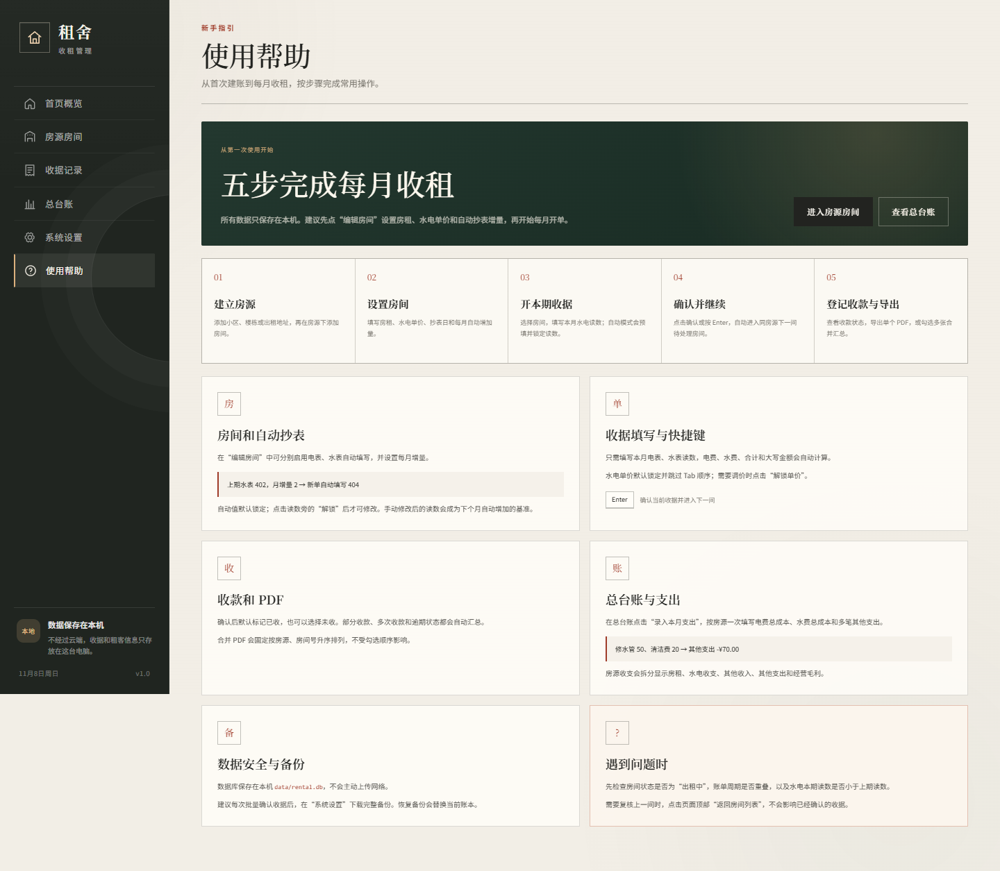
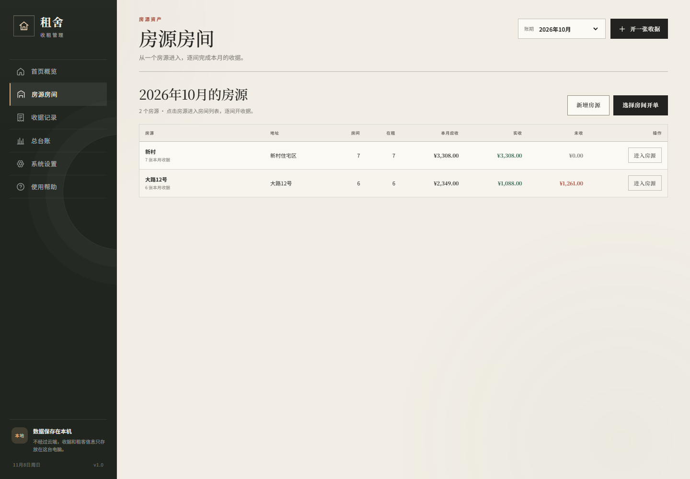
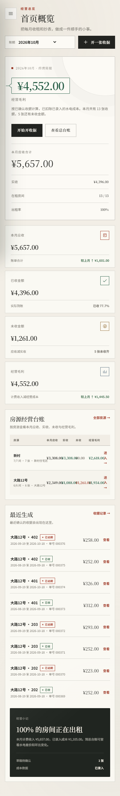

# 租舍 · 收租管理

一个在本机离线运行的出租房收租管理工具。围绕“房源 → 房间 → 水电读数 → 确认收据”的流程设计，适合房东或房屋管理人员管理多套房、多房间的月度收租、水电、收款和经营支出。

所有业务数据保存在本机 SQLite 数据库，不需要云端账号，也不会主动上传租客信息。

## 界面预览

### 首页概览



### 月度收据



### 总台账



### 使用帮助



### 房源列表与手机端





## 主要功能

- 管理多个房源、房间、租客、电话、房租、水电单价和抄表日。
- 按房间设置电表、水表每月自动增量，新单自动填写并锁定读数。
- 支持手动解锁水电读数、修改单价、添加其他费用和负数房租调整。
- 编辑页突出显示上期与本期水电费用对比，变化超过 ¥100 时标红。
- 支持按 `Enter` 快捷确认，并自动进入同房源下一间待处理房间。
- 生成 A5 横向 PDF 收据，支持单个 PDF、合并 PDF 和批量 ZIP。
- 合并 PDF 固定按房源顺序、房间号自然升序排列。
- 支持收款状态切换、部分收款、逾期状态和收款记录。
- 总台账按房源录入总水电成本和多笔其他支出，并分项展示房租、水电收支、其他支出和经营毛利。
- 支持完整数据库备份与恢复。
- 内置“使用帮助”页面，覆盖首次建账、自动抄表、收款、PDF 和台账支出。

## 快速启动

### 环境要求

- Python 3.10 或更高版本
- Windows 用户可直接双击启动脚本

安装依赖：

```powershell
python -m pip install -r requirements.txt
```

Windows 双击：

```text
启动收租管理.bat
```

或者使用命令行：

```powershell
python app.py
```

程序会启动本地服务并打开：

```text
http://127.0.0.1:8848/
```

关闭运行程序的命令行窗口即可停止服务。

## 第一次使用

1. 打开“房源房间”，点击“新增房源”。
2. 进入房源后点击“新增房间”，填写房间号、房租、水电单价和抄表日。
3. 如有需要，在“编辑房间”中启用电表、水表每月自动增量。
4. 进入房间，确认第一张收据的账单周期。
5. 填写本月水电读数并确认；程序会分配正式单号并生成 PDF。
6. 在“总台账”录入房东实际支付的水电费和其他支出。

也可以在空账本中点击“载入示例数据”，快速体验完整流程。示例数据均为虚构内容。

## 使用帮助

程序左侧导航栏内包含“使用帮助”，包括：

- 五步完成每月收租
- 房间与自动抄表设置
- 收据填写和 `Enter` 快捷键
- 收款与 PDF 导出
- 总台账支出录入
- 数据备份与常见问题

## 数据与隐私

默认数据库位置：

```text
data/rental.db
```

- 数据仅保存在本机，不会主动上传。
- `data/`、数据库文件、备份文件和测试数据库都已加入 `.gitignore`。
- 建议定期在“系统设置”下载完整备份。
- 恢复备份会替换当前账本，操作前应先下载现有备份。

## 项目结构

```text
app.py             HTTP 服务和 REST API
rental_core.py     数据模型、账务计算、备份与 PDF 导出
receipt_pdf.py     PDF 收据排版与人民币大写
web/               离线单页前端
tests/             后端与浏览器自动化测试
data/              本机数据库目录（不提交到 Git）
docs/screenshots/  公开示例数据截图
```

## 测试

后端测试：

```powershell
python -m unittest discover -s tests -p "test_core.py" -v
```

浏览器自动化测试需要 Node.js 和 Playwright：

```powershell
npm install
npx playwright install chromium
python app.py --port 8849 --db data/test.db --no-browser
$env:BASE_URL="http://127.0.0.1:8849"
npm run test:ui
```

其他界面回归测试：

```powershell
npm run test:ui:auto
npm run test:ui:negative
npm run test:ui:ledger
```

## 第一版边界

- 不支持微信、短信或邮件自动发送。
- 不支持在线支付或支付平台对账。
- 不支持云端多设备同步。
- 房间级别仅展示用量和向租客计收的费用，不自动分摊房源成本。
- 当前定位为单机单人使用版本。
